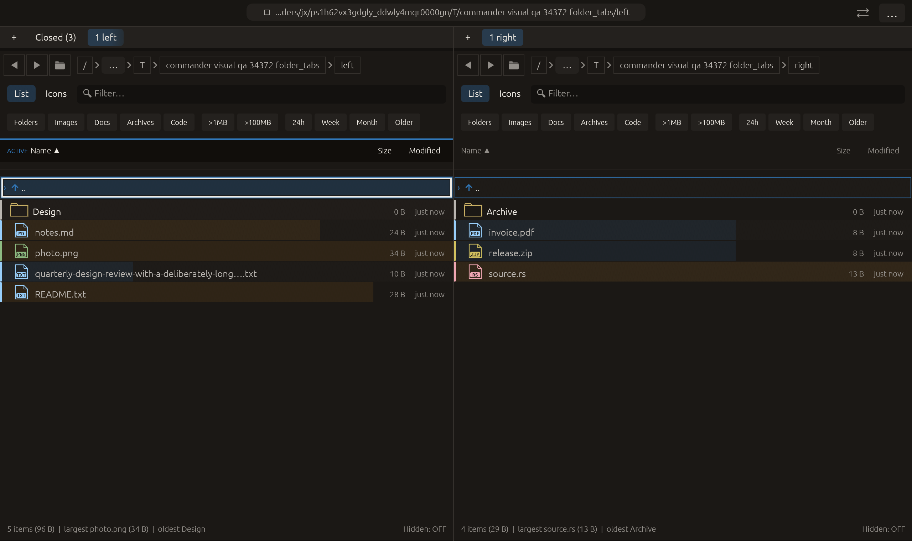

# Close groups of folder tabs — 2026-10-27

Independent adaptation inspired by [Explorer++ Close Other Tabs](https://explorerplusplus.readthedocs.io/en/latest/panes/tab_bar.html)
and [Double Commander’s tab commands](https://doublecmd.github.io/doc/en/cmds.html).
No upstream code or new dependency was added.

## Behavior

A folder tab's context menu now offers:

- **Close other folder tabs**: keep only this tab and activate it, even when its menu was opened while it was inactive.
- **Close folder tabs to the right**: retain this tab and its left prefix. Keep the active tab if it survives; otherwise activate the menu's tab.

The last tab can never be closed by these actions. Impossible actions are disabled.
They operate only on the addressed pane, without cycling through the removed
tabs or navigating the surviving panel. The existing busy-operation, active-delete
and pending-modal gate applies before any workspace change. UI actions are
collected during strip rendering and applied afterward, as with other tab actions.

Removed panels enter the existing Closed history, preserving suspended runtime
state. Removal runs in descending index order so LIFO reopening reconstructs the
original tab order. The history remains capped at eight entries for this run;
older closed entries can be evicted. Group close is not a new filesystem Undo
operation. Existing reopen commands restore individual tabs. One successful
group operation updates the tab revision once and resets existing preview/drag
presentation through the established path. A no-op does not change the revision.

No tab locking, close-all-across-both-panes command or new shortcut was introduced.

## Verification

- Focused workspace tab tests: **17 passed**.
- Full current regression: **2341 passed, 3 ignored**.
- All-targets Clippy with visual-qa and `-D warnings`: passed.
- Formatting and scoped whitespace checks: passed.

The new matrix covers 64 combinations of left/right pane, menu-anchor position,
active-tab position and close mode across four tabs. It verifies survivors,
active indices, the untouched opposite pane, a single revision update, and LIFO
restoration of original saved entries. Additional checks cover single-tab/no-op
and invalid anchors (including usize::MAX), plus pending rename-modal rejection.
Existing tests cover preserved runtime selection/filter/history/view state and
bounded closed-tab history.

The native folder_tabs scenario uses raw pointer input to open the context menu
of an inactive tab and click Close folder tabs to the right. It requires two
survivors, then opens the remaining inactive first tab's menu and clicks Close
other folder tabs. Capture requires one surviving root tab, active index zero
and three Closed history entries (one existed before the group actions). The
actual eframe/Glow frame was visually inspected. All **14 manifest checks**
passed, with no native clipboard/opener/trash effects. This extends the existing
folder_tabs case in the 20-case CI matrix; no remote CI, push, commit or performance
gain is claimed.

